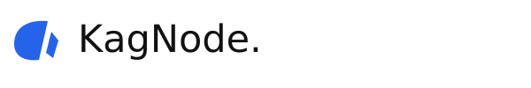

<p align="center"></p>

# KagNode logos

The canonical KagNode geometric mark and its wordmarks, product layouts and icons. Combined marks use **KagNode.** with a period. Small symbol-only icons do not.

- `source/`: canonical SVG, complete commented logo sheet and font notices.
- `svg/`: transparent marks, outlined wordmarks and product versions for light, dark, blue, black and white use.
- `png/`, `webp/`: transparent raster assets.
- `pdf/`, `eps/`: vector print assets.
- `icons/`: transparent favicons, PNG sizes from 16 to 1024, ICO and ICNS.
- `ascii/`: large 77-column wordmark, 30-column compact and 18-column small banners, plus a symbol-only mark; each has plain ASCII and blue ANSI versions.
- `manifest.json`: checksums for generated variants.

Product variants include Cloud, Developer, Operator, Mail, VPN, HTTP Boot, CLI and **[Project]** as the placeholder. SVG comments identify the canvas, symbol, wordmark and product phases. The editable sheet preserves its existing section comments; generated wordmarks use outlined typography to avoid external font dependencies.

## Rebuild

```sh
python3 -m venv .venv
.venv/bin/pip install cairosvg pillow fonttools
.venv/bin/python scripts/generate.py
```

Install the DejaVu Sans system font at the path in the generator. Its notices are retained in `source/FONT-NOTICES.txt`. `python scripts/ascii_art.py` rebuilds only the terminal artwork and its checksums. The generator makes no network requests and uses no external image assets.

See [LICENSE](LICENSE) for artwork permission and [BRAND-POLICY.md](BRAND-POLICY.md) for identity use. These assets do not assert worldwide uniqueness or trademark registration. Software in the KagNode application repositories has its own license.
