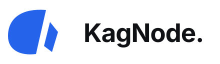

<!-- Retained operational documentation; historical version labels refer to their original release. -->
<p align="center"></p>

# KagNode logos

The canonical KagNode geometric mark and its wordmarks, product layouts and icons. Combined marks use **KagNode.** with a period. Small symbol-only icons do not.

- [`symbols/`](symbols/): **24 symbol-only variants**, without words or a period. Black, white, charcoal, gray, light gray, slate, blue and light blue; solid, outline and two-tone treatments. Transparent SVGs and PNGs at 16–2048 px. See the [variant guide](../symbols/README.md).
- `source/`: canonical SVG, complete commented logo sheet and font notices.
- `svg/`: transparent marks, outlined wordmarks and product versions for light, dark, blue, black and white use.
- [`png/`](png/): transparent raster assets, including all **240 symbol-only PNGs** directly in this folder. Names follow `mark-{style}-{color}-{size}.png`, for example [`mark-solid-gray-1024.png`](../png/mark-solid-gray-1024.png).
- `webp/`: lossless raster assets.
- `pdf/`, `eps/`: vector print assets.
- `icons/`: transparent favicons, PNG sizes from 16 to 1024, ICO and ICNS.
- `ascii/`: a 112-column display, 68-column standard banner, 43-column wordmark, 22-column compact and 18-column small banners, plus the symbol alone. Each has plain ASCII (`.txt`), UTF-8 full blocks (`-blocks.txt`) and blue/white ANSI (`.ansi`) versions. Widths count terminal cells; use a monospaced font. The CLI and HTTP Boot select a smaller layout automatically and reserve a column to prevent wrapping. Redirected output stays plain ASCII without escape codes.
- `svg/github-wordmark.svg`: an adaptive wordmark, matching the VPN header, for light and dark README backgrounds.
- `manifest.json`: checksums for generated variants.

Product variants include Cloud, Developer, Mail, Passwords, Media, Core, Entropy, VPN, HTTP Boot, CLI and **[Project]** as the placeholder. SVG comments identify the canvas, symbol, wordmark and product phases. The editable sheet preserves its existing section comments; generated wordmarks use outlined typography to avoid external font dependencies.

Entropy has a separate product E and [compact header lockups](ENTROPY.md). The KagNode canonical symbol and all prior download paths remain unchanged.

## Rebuild

```sh
python3 -m venv .venv
.venv/bin/pip install -r requirements-artwork.txt
.venv/bin/python scripts/generate.py
```

Install the DejaVu Sans system font at the path in the generator. Its notices are retained in `source/FONT-NOTICES.txt`. `python scripts/ascii_art.py` rebuilds only the terminal artwork and its checksums. The generator makes no network requests and uses no external image assets.

`python scripts/symbols.py` rebuilds only the symbol collection and updates its checksums. This uses the paths in `source/canonical-mark.svg` directly and requires no fonts. Existing wordmarks and terminal artwork remain unchanged.

See [LICENSE](LICENSE) for artwork permission and [BRAND-POLICY.md](../BRAND-POLICY.md) for identity use. These assets do not assert worldwide uniqueness or trademark registration. Software in the KagNode application repositories has its own license.
